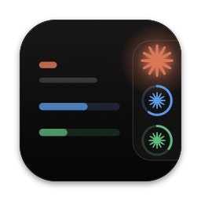
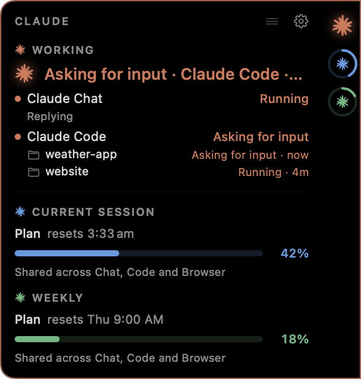

  

<h1 align="center">ClaudeNotchEV</h1>

A thin tab on the edge of your screen that shows what Claude is doing, and how much of your plan you've used.

<h3 align="center">
  <a href="https://github.com/MilkshakeEV/ClaudeNotchEV/releases/latest/download/ClaudeNotchEV.dmg">⬇︎ Download ClaudeNotchEV</a>
</h3>

<a href="https://github.com/MilkshakeEV/ClaudeNotchEV/releases/latest/download/ClaudeNotchEV.dmg">ClaudeNotchEV.dmg</a> · always the newest version

  

## Requirements

- Any Mac, Apple silicon or Intel, with or without a notch
- macOS 14 Sonoma or newer
- For the Claude sources: the Claude desktop app and/or Claude Code (each is optional)

## Install

1. Download **ClaudeNotchEV.dmg** with the button above and open it.
2. Drag **ClaudeNotchEV** onto the **Applications** folder.
3. Open it from Applications. It isn't notarized by Apple, so the first time macOS says it can't
   check it: click **Done**, then open **System Settings → Privacy & Security**, scroll to
   **Security** and click **Open Anyway** next to ClaudeNotchEV. You only do this once.

More detail, including what to do if the Open Anyway button doesn't appear: [INSTALL.md](INSTALL.md).

## What it shows

Move the pointer onto the tab and it grows into a small panel:

- **WORKING** (orange): Claude Chat (the desktop app's chat), Claude Code and Claude Browser,
  each on its own row: Asking for input, Running, Ready or Off. The tab glows yellow when Claude needs you.
- **CURRENT SESSION** (blue) and **WEEKLY** (green): your plan's usage, shared across Chat, Code
  and Browser, and optionally Claude Code's own token counts.

Anything that's a guess is tagged **Estimated**. Sources the app can't observe on your Mac stay hidden.

## Updates

Open **Settings → About** and click **Check for Updates**. If there's a newer version, the
release page opens; download the new DMG and drag the app into Applications again. Everything is replaced,
including the icon, and your settings are kept.

## Privacy

No accounts, no tracking. Nothing leaves your Mac except **Check for Updates** (asks GitHub for
the latest release, only when you click it) and **plan usage**, if you turn it on (asks Claude's
usage service with your own Claude Code login). Your messages are never read.

Not affiliated with or endorsed by Anthropic.

[All releases](https://github.com/MilkshakeEV/ClaudeNotchEV/releases)
